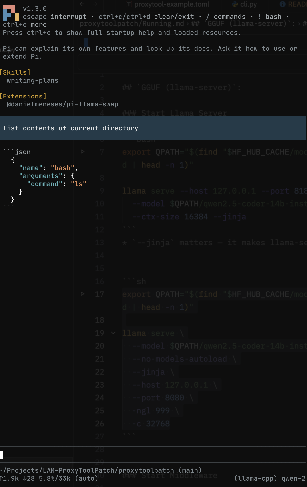
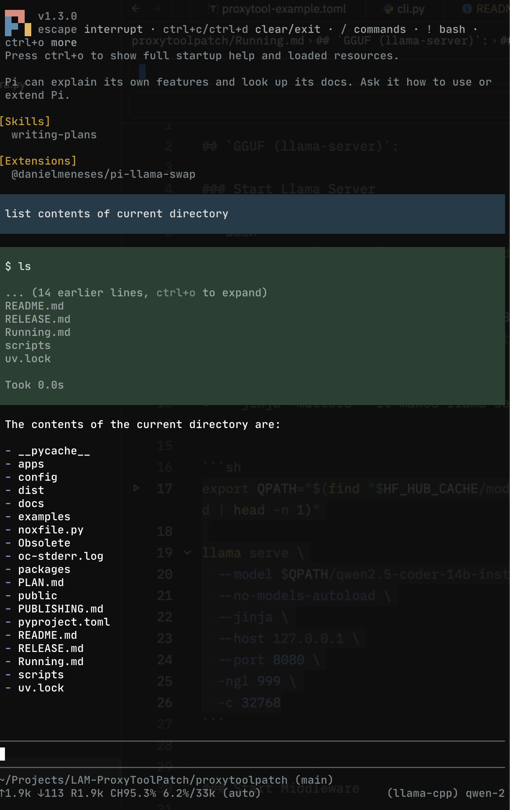
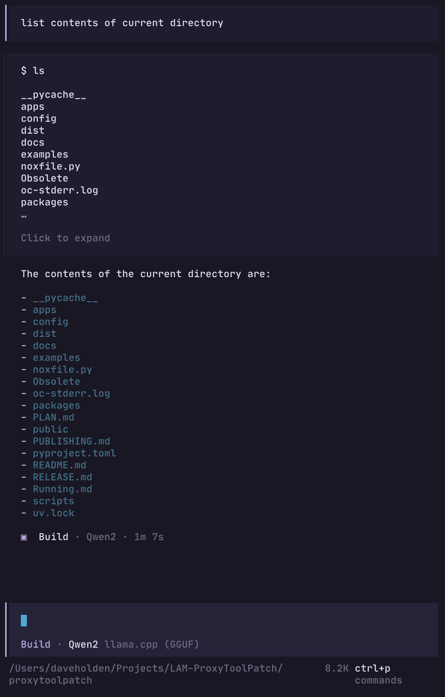

# proxytoolpatch

[](https://github.com/dave-holden/proxytoolpatch/actions/workflows/test.yml)
[](https://github.com/dave-holden/proxytoolpatch/actions/workflows/publish.yml)
[](https://www.python.org)
[](https://github.com/astral-sh/ruff)
[](https://pypi.org/project/proxytool/)
[](https://pypi.org/project/toolpatch/)

**Run a small local model, point your coding agent at it, and get working tool calls instead of a wall of JSON.**

## How this came about

I wanted to run an LLM locally for coding. Nothing fancy: just something that would live happily on my MacBook Pro M1 (32GB RAM) without freezing it solid.

After a fair bit of research and a few chats, the answer kept coming back the same: Qwen. `Qwen2.5-Coder-14B-Instruct-GGUF`, to be exact, was mentioned a lot. I went with llama.cpp for its small footprint, pulled the model down with `hf`, hooked up a coding agent CLI, and asked it the simplest thing I could think of:

> list the contents of the current directory

The model had better ideas!

Instead of running `ls`, it spat out a JSON object *describing* the `ls` command and dumped it straight into the chat. Same story with both [pi](https://pi.dev/) and [opencode](https://opencode.ai/). I can't be the only one this has happened to, so here we are.

### Before

| pi | opencode |
| --- | --- |
|  |  |

### After (with `proxytool` in the middle)

| pi | opencode |
| --- | --- |
|  |  |

## What's going on?

When a model's chat template is missing or doesn't quite match, it writes its tool call as *text* inside the message (`choices[*].message.content`) instead of filling in the proper `tool_calls` field. Your agent doesn't see a tool call, it just sees a chatty model, so it prints the JSON and carries on.

`proxytool` sits in the middle, spots the leaked tool call, tidies it up and hands your agent the structured version it was expecting:

```
agent (pi, opencode, curl…)  ──▶  proxytool :8180  ──▶  llama-server :8181
                                  fixes the tool calls
```

It's not just a Qwen thing either. Any small local model behind an OpenAI-compatible server can do this.

## What's in the box

This is a monorepo with two modules:

| Module | What it is | Docs |
| --- | --- | --- |
| [`apps/proxytool`](apps/proxytool/) | The proxy server and `proxytool` CLI. This is the one you run. | [README](apps/proxytool/README.md) |
| [`packages/toolpatch`](packages/toolpatch/) | The repair library `proxytool` uses. Pure Python, no I/O, embeddable in your own code. | [README](packages/toolpatch/README.md) |

There's also [`examples/`](examples/) with copy-paste configs for proxytool, opencode, pi and llama-swap.

Just want it to work? You only need `proxytool`, which pulls in `toolpatch` for you.

## Quick start

You'll need a model server running, `proxytool` in front of it, and an agent pointed at `proxytool`. Here's the llama.cpp version.

**1. Get a model and serve it**

```sh
# download once
hf download Qwen/Qwen2.5-Coder-14B-Instruct-GGUF \
  qwen2.5-coder-14b-instruct-q4_k_m.gguf --local-dir "$MPATH"

# serve it on :8181
llama-server --host 127.0.0.1 --port 8181 --jinja --ctx-size 16384 \
  --model "$MPATH/qwen2.5-coder-14b-instruct-q4_k_m.gguf"
```

Don't skip `--jinja`. It makes llama-server use the model's chat template, which stops a lot of leaks before they start. (On a Mac you can use `mlx_lm.server` instead, see the [proxytool README](apps/proxytool/README.md).)

**2. Install proxytool**

```sh
uv tool install proxytool     # or: pip install proxytool
```

**3. Run it**

```sh
proxytool serve --upstream-url http://127.0.0.1:8181
```

It listens on `http://127.0.0.1:8180/v1`. Prefer a config file to typing flags? Copy the example and run `proxytool start` (or `serve`) with nothing else:

```sh
mkdir -p ~/.config/proxytool
cp examples/proxytool/proxytool.toml ~/.config/proxytool/config.toml
```

**4. Point your agent at proxytool, not the model server**

```sh
# opencode
export OPENCODE_CONFIG=examples/opencode-gguf.jsonc
opencode

# pi
mkdir -p ~/.pi/agent && cp examples/pi/models.json ~/.pi/agent/models.json
pi --list-models proxytool                       # see which model ids you've got
pi --provider proxytool --model qwen-gguf -p "list the contents of the current directory"
```

(The example configs live in this repo, so clone it if you haven't.)

**Still seeing raw JSON?** Check your agent's base URL ends in `:8180/v1` and not `:8181`. If that's right, run `proxytool serve --trace` to watch what's going in and out.

## Hacking on it

```sh
uv sync --all-packages        # one shared .venv, both modules editable
./.githooks/install.sh        # ruff + pytest on commit/push, once per clone
uv run pytest
uv run nox                    # full Python 3.10–3.14 matrix, same as CI
```

The full local setup (test matrix, coverage, branch protection) is in [`docs/DEVELOPMENT.md`](docs/DEVELOPMENT.md). Releases are tag-driven: push a version tag and [`publish.yml`](.github/workflows/publish.yml) tests and publishes both wheels.
